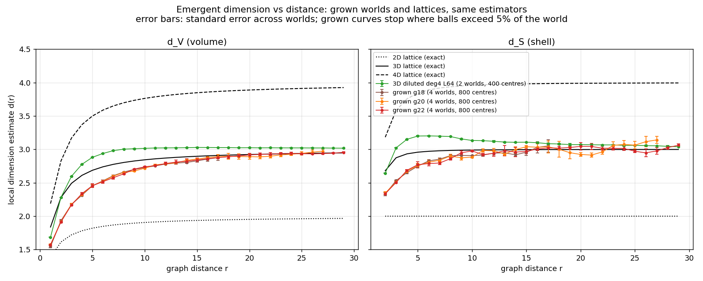

# Step 1: dimension of the grown world at larger scales

**Question.** As distance grows, does the grown world's dimension keep rising toward 3, level
off below 3, or go past 3? This matters because the universality test (Step 3) compares the
grown world's stiffness exponent with the dimension the world actually has at the same scale.

**Prediction** (committed before measuring, `predictions/step1_dimension.md`, commit 9e3e6fc):
levels off near 3 within ±0.2 (55%), keeps rising past 3 (30%), plateaus below 3 (15%).

## What was measured

- 4 independently grown worlds (seeds 0–3) at 22 generations (770k–880k nodes), and the same
  seeds at 18 and 20 generations to check for finite-size effects. 200 random centres per world.
- Number of nodes at distance exactly r from each centre, S(r), out to r = 30. Raw counts are
  in `results/dimension/*.npz`. Reproduce with `python dimension.py measure` then `report`.
- Two estimators. d_V is the original one, the local slope of log V(r) against log r, where V
  is the number of nodes within distance r. d_S is 1 + the slope of log S(r), which has much
  less short-range bias on lattices.
- References: exact counts on infinite 2D, 3D and 4D lattices, which show each estimator's
  own bias. Also the 3D lattice diluted to mean degree 4, the control used in the stiffness
  runs. The same search code run on a periodic 3D lattice reproduces the exact counts.
- Saturation: on 22-generation worlds a radius-30 ball holds 1.8% of the world on average
  (worst centre 3.6%). The 18-generation worlds, about 70k nodes, which is the size of the
  earlier measurement, saturate past r ≈ 20 (balls hold up to 39% of the world). Any window
  where balls hold more than 5% of the world is excluded below.

## Result

Fits of d_S over distance windows. Errors come from a bootstrap that resamples worlds, then
centres within each world, so they include world-to-world variation.

| World | r 3–6 | r 6–12 | r 12–20 | r 20–29 |
|---|---|---|---|---|
| 2D lattice (exact) | 2.000 | 2.000 | 2.000 | 2.000 |
| 3D lattice (exact) | 2.942 | 2.985 | 2.996 | 2.998 |
| 4D lattice (exact) | 3.787 | 3.943 | 3.983 | 3.993 |
| 3D diluted to degree 4 (2 worlds) | 3.167 ± 0.011 | 3.168 ± 0.005 | 3.097 ± 0.003 | 3.061 ± 0.002 |
| grown, 22 generations (4 worlds, 800 centres) | 2.717 ± 0.026 | 2.889 ± 0.019 | 2.994 ± 0.031 | 3.001 ± 0.029 |
| grown, 20 generations | 2.709 ± 0.024 | 2.886 ± 0.021 | 3.002 ± 0.045 | saturated |
| grown, 18 generations | 2.694 ± 0.022 | 2.893 ± 0.017 | saturated | saturated |

**Answer: the grown world's dimension rises and levels off at 3.** Over r = 12–29 the shell
estimator gives 3.00 ± 0.03, and there is no sign of it continuing past 3 at these distances.
The original volume estimator agrees: from r ≈ 20 on, the grown world's d_V falls on the
exact 3D lattice curve (2.92, 2.94, 2.95 at r = 20, 25, 29 for both). That curve sits below 3
only because of that estimator's own bias. Where the worlds are not saturated, the curves for
18, 20 and 22 generations agree, so this is a property of the world's local geometry, not of
its size.

The outcome is the one I gave 55%, and it came out tighter than the ±0.2 I allowed for.

## What it changes

- **The earlier "2.87 at r = 15" was an estimator effect, not a lower dimension.** The 3D
  lattice reads 2.90 there with the same estimator. The grown world is three-dimensional at
  large scale.
- **At the radii of the stiffness runs (R = 3–9), the grown world is not yet
  three-dimensional.** Its d_S is 2.7–2.9 there, still rising. At the same radii the 3D lattice
  reads 2.94–2.99 and the diluted lattice 3.17. The order of these effective dimensions,
  2D (2.0) < grown (≈ 2.8) < 3D (≈ 2.97) < diluted (≈ 3.17), matches the order of the
  ball-method θ: −0.17 < +0.26 < +0.52 < +0.65. That is consistent with the working
  hypothesis that θ follows the dimension the system actually has at the measured scale.
  It is only an ordering across four worlds, not a calibration; that is Step 2's job.
- **This gives Step 3 a concrete prediction.** If universality holds, the grown world's θ
  measured over sliding windows of R should rise with R. Once R ≳ 12, where d_S reaches 3, it
  should approach what the same method gives for 3D lattices at the same R. A θ that stays
  flat while the dimension climbs to 3 would mean the growth process changes the physics.

## Caveats

- These are graph distances out to r = 29 on worlds of under a million nodes. Nothing here
  rules out a slow drift beyond r = 30. The window fits exclude d_S > 3.1 at r = 20–29 at
  about 3σ.
- Four worlds of one rule. Per-world d_S values at single distances scatter by about ±0.1
  (see `results/dimension/report.txt`). The window fits average this out.
- The diluted lattice's d_S approaches 3 from above: removing bonds makes graph distances
  longer than lattice distances, so shells grow faster at short range. It is a useful
  reminder that "effective dimension at short range" depends on the estimator and on local
  structure, not only on the asymptotic dimension.
- Code provenance: the measurement ran from the working tree at commit 9e3e6fc, before
  `dimension.py` was committed. Only the report section has changed since: the saturation
  cut and the window fits.
