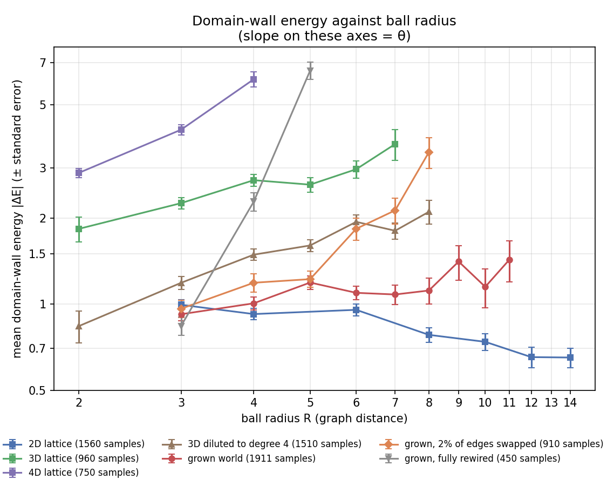
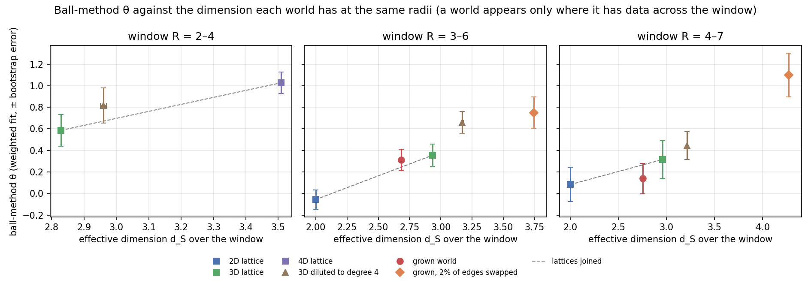

# Step 2: what the ball method gives for lattices of known dimension

**Question.** The ball method measures θ at small sizes, where every method is biased. Before
reading anything into the grown world's θ, we need to know: for a lattice whose dimension we
know, what does this method actually return at the radii we can reach? And at matched radii,
does the grown world sit where a lattice of its effective dimension would?

## What was run

- New exact samples (all proven optimal, `mip_rel_gap` 0, 1-hour limit, **no timeouts**):
  2D lattice R = 10, 12, 14 (150/100/100), 3D lattice R = 5, 6, 7 (110/100/40),
  4D lattice R = 2, 3, 4 (300/300/150). 1350 samples, 2.9 h on 12 threads.
- Combined with the legacy samples (`results/legacy.jsonl`): 2D to R = 3–14, 3D to R = 2–7,
  diluted 3D R = 2–6, grown R = 3–9.
- Hardest point: 3D lattice R = 7 (575 spins), median solve 27 min, slowest 57 min. That is
  close to the 1-hour limit, so 3D R = 8 is out of reach for exact solving on this machine.
- `python calibrate.py` reproduces every number below and writes
  `results/calibration/report.txt`, `windows.json` and the two figures.

How θ is fitted: the slope of log mean|ΔE| against log R over a window of radii, weighted
by (mean/sem)². Errors are bootstrap standard deviations (for grown and diluted worlds the
bootstrap resamples whole worlds first, so world-to-world spread is included). Effective
dimension of a world over a window: the shell estimator d_S(r) from Step 1, averaged over
the same radii, measured on the very worlds the samples used.

## Result 1: on the 2D lattice the method converges to the published value

| 2D lattice window | R 3–6 | R 4–8 | R 6–10 | R 8–12 | R 10–14 | all, R 3–14 |
|---|---|---|---|---|---|---|
| θ (weighted) | −0.06 ± 0.09 | −0.18 ± 0.10 | −0.54 ± 0.15 | −0.41 ± 0.24 | −0.40 ± 0.31 | **−0.265 ± 0.039** |

(Windows of three radii from `python analyze.py --windows 3`.) The published value for the
2D Gaussian spin glass is about −0.28. At small radii the
method reads too high (near 0 at R = 3–6). From R ≈ 8 on, the windows are consistent with
−0.28 within their errors. So in 2D the method's bias is a small-size effect that has
mostly gone by R ≈ 8–10. This is the only dimension where we can check this, because only
2D can be solved exactly to R = 14.

## Result 2: in 3D and 4D the method reads high at every reachable radius

| World | window | θ (weighted) | published (large-size) value |
|---|---|---|---|
| 3D lattice | R 2–7, all | +0.43 ± 0.08 | about +0.24 |
| 3D lattice | R 3–6 | +0.36 ± 0.10 | |
| 3D lattice | R 4–7 | +0.32 ± 0.18 | |
| 3D lattice | R 5–7 | +0.87 ± 0.35 | |
| 4D lattice | R 2–4 | +1.03 ± 0.10 | about +0.6 |

In 3D the reachable radii (R ≤ 7) are too small for the method to settle; single windows
scatter between +0.16 and +0.87 with errors of 0.1–0.35. In 4D only R = 2–4 is reachable
and the reading is far above the published value. **So the method's θ is not the true θ in
3D or 4D at these sizes, and "θ = 0.52 for the 3D lattice" from the legacy runs was not a
measurement of the 3D exponent.** The handoff already warned about this; Step 2 puts numbers
on it.

## Result 3: at matched radii, the method's θ rises with effective dimension, and the grown world sits on the lattice line

At each window the lattices define a line: what the method returns for a lattice of a given
effective dimension at those radii (about +0.44 per unit of dimension at R = 3–6 and 2–4).
Reading the grown and diluted worlds off that line (linear interpolation between the two
nearest lattices, errors combined):

| World | window | d_S over window | lattice line predicts | measured | difference |
|---|---|---|---|---|---|
| grown | R 3–6 | 2.69 | +0.25 ± 0.08 | +0.31 ± 0.15 | +0.07 ± 0.17 (0.4σ) |
| grown | R 4–7 | 2.78 | +0.27 ± 0.15 | +0.14 ± 0.19 | −0.13 ± 0.24 (0.6σ) |
| diluted 3D | R 2–4 | 2.96 | +0.67 ± 0.12 | +0.82 ± 0.17 | +0.15 ± 0.21 (0.7σ) |
| diluted 3D | R 3–6 | 3.17 | +0.46 ± 0.13 (extrapolated) | +0.65 ± 0.11 | +0.19 ± 0.17 (1.1σ) |
| diluted 3D | R 4–7 | 3.22 | +0.38 ± 0.23 (extrapolated) | +0.58 ± 0.20 | +0.21 ± 0.31 (0.7σ) |

**Answer.** At the radii we can reach (R ≤ 7), the grown world's θ is what a lattice of its
effective dimension gives with this method, within errors of about ±0.2. Its lower θ than
the 3D lattice in the legacy runs is accounted for by its lower effective dimension at
those radii (about 2.7–2.8, not 3), which is the working hypothesis. The diluted lattice
sits slightly above the line in every window (0.4–1.1σ each, not significant on its own).

**Update after Step 4** (see `reports/step4_controls.md`): the diluted lattice now has
data to R = 8, and `calibrate.py` now uses the bootstrap over samples as the primary error
(the version that also resamples worlds is reported alongside as an upper bound; no grown
world differs detectably from the others). The table above is as first written. With the
current data the differences are: grown R 3–6 +0.07 ± 0.13, R 4–7 −0.13 ± 0.20; diluted
R 3–6 +0.20 ± 0.17, R 4–7 +0.07 ± 0.26. The conclusion is unchanged.

## What it changes

- **The legacy θ values should not be compared with published exponents.** The method reads
  high in 3D and 4D at these sizes, and its 3D readings jump around from window to window.
  Comparisons only mean something between worlds at the same radii.
- **Up to R = 7 there is no sign that the growth process changes the physics.** But the test
  is weak: ±0.2 on θ, across a dimension range where the lattice line itself only moves by
  about 0.4.
- **Beyond R = 7 there is no 3D lattice to compare with.** The grown world's R = 9–13 data
  (Step 3) can only be compared with (a) the published 3D value and (b) the 2D evidence that
  the method's bias fades by R ≈ 8–10. That is weaker than a same-radius comparison.
- **The method's θ can drift with R at fixed dimension.** In 2D it falls from about 0 to about
  −0.4 as R grows. So a grown-world θ that changes with R is not by itself evidence of
  changing dimension. I recorded this, and the precision I expect at R = 9–13, in an addendum
  to the Step 3 prediction before analysing Step 3 (commit 4745394).

## Caveats

- One lattice size per dimension (L = 50, 24, 10), checked large enough for each R
  (L ≥ 2R + 2); the 3D lattice and 4D lattice are single worlds with fresh couplings per
  sample, so their bootstrap errors are over couplings and centres only.
- Two-radius windows (R 3–4) are too noisy to use (errors 0.2–0.3); they are in
  `report.txt` but not in the conclusions.
- The effective dimension at very small r depends on the estimator (Step 1). Using the
  volume estimator instead would move every world left by a similar amount, but not by
  exactly the same amount, so the lattice line is only as good as d_S is.
- The published values quoted (2D about −0.28, 3D about 0.24, 4D about 0.6) are from
  domain-wall studies at much larger sizes with periodic/antiperiodic boundaries; they are
  reference points, not something this method is expected to reproduce at R ≤ 7.
