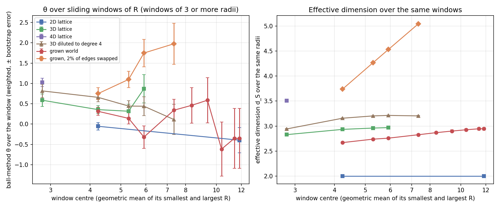
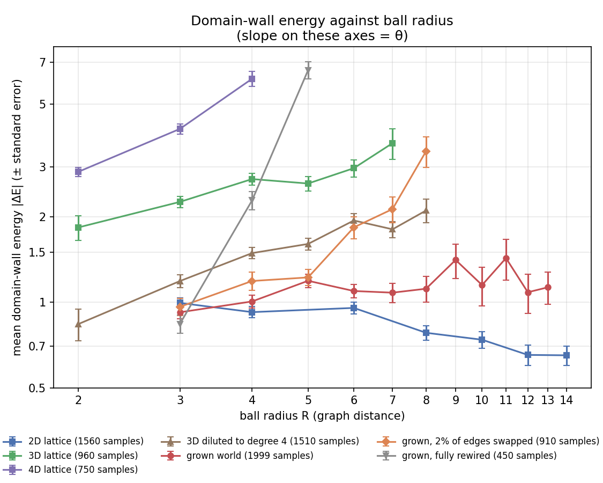

# Step 3: the grown world's θ out to R = 13

**Question.** Up to R = 7 the grown world's θ is what a lattice of its effective dimension
gives (Steps 2 and 4). Its dimension keeps rising, to about 2.95 at R = 10–13. Once the
world is three-dimensional, does its θ look like a 3D spin glass's (universality), or does
the growth process change the physics?

The prediction and its test were committed before this analysis:
`predictions/step3_universality.md` (2026-11-23), with an addendum (commit 4745394) that
fixed the large-R test: over R = 9–13 the grown θ is "consistent with 3D" if it lies within
2 errors of the range 0.24–0.5, and counts against universality only if it is more than 2
errors outside it.

**Short answer: inconclusive.** The committed test passes, but only because the errors are
large. The same data are just as consistent with a 2D-like θ. The addendum expected this
outcome from the sample counts alone, and that is what happened.

## What was run

- Grown worlds, 16 generations. R = 9 on seeds 0–3; R = 10–13 on seeds 0–7. All solves are
  exact (proven optimal, `mip_rel_gap` 0), from `plans/step3_grown.json`.
- First pass: 1-hour limit, 5.8 h on 12 threads. 11 samples timed out: 3 of 48 at R = 12
  and 8 of 40 at R = 13, all among the largest balls (1,300–2,200 spins).
- Those 11 were re-solved with a 4-hour limit, and **all 11 were solved**. The slowest took
  4.2 h for its two solves. So no sample is excluded, and the bias from dropping hard (large)
  balls is avoided.
- Solve time for R ≥ 9 was about 83 CPU-hours. The median per sample at R = 13 was 31 min.

| R | 9 | 10 | 11 | 12 | 13 |
|---|---|---|---|---|---|
| samples | 101 | 100 | 80 | 48 | 40 |
| mean \|ΔE\| | 1.41 ± 0.20 | 1.15 ± 0.18 | 1.43 ± 0.23 | 1.09 ± 0.17 | 1.13 ± 0.15 |
| world-to-world difference (Kruskal–Wallis p) | 0.59 | 0.58 | 0.52 | 0.80 | 0.57 |

R = 9 includes 41 legacy samples. No radius shows a detectable difference between worlds,
so the primary error is the bootstrap over samples. The bootstrap that also resamples
worlds is given in brackets as an upper bound. At R = 9–13 the spread of |ΔE| is 0.8–1.6
times its mean, mostly above the ≈ 1 assumed in the addendum.

`python calibrate.py` reproduces every number here (`results/calibration/report.txt`, which
now also lists the wide windows 3–13, 5–13 and 9–13).

## Result 1: the committed test passes, but cannot tell 2D from 3D

| Grown world | θ (weighted) | d_S over the window |
|---|---|---|
| **R 9–13 (the committed test)** | **−0.55 ± 0.47** (± 0.55) | 2.94 |
| R 9–12 | −0.62 ± 0.67 | 2.93 |
| R 10–13 | −0.35 ± 0.74 | 2.95 |

- **Against the committed test.** −0.55 is 0.79 below 0.24, which is 1.7 errors (1.4 with
  the larger error). It is within 2 errors of the 3D range, so by the rule written in
  advance it is "consistent with 3D" and does not count against universality.
- **What the test cannot do.** The same number is 0.6 errors from the published 2D value
  (−0.28). It is also 0.3 errors from the ball method's 2D lattice reading at the same
  radii (−0.40 ± 0.31 at R = 10–14). So the data do not separate a 2D-like θ from a 3D-like
  one. The central value actually leans to the 2D side.
- **The precision was as predicted.** The addendum expected ±0.45; the fit gives ±0.47.

## Result 2: the sliding windows show neither a rise nor a clear absence of one

| Grown, window | 3–6 | 4–7 | 5–7 | 6–9 | 7–10 | 8–11 | 9–12 | 10–13 |
|---|---|---|---|---|---|---|---|---|
| θ | +0.31 | +0.14 | −0.32 | +0.34 | +0.46 | +0.59 | −0.62 | −0.35 |
| error | 0.10 | 0.14 | 0.27 | 0.27 | 0.43 | 0.54 | 0.67 | 0.74 |
| d_S | 2.67 | 2.74 | 2.79 | 2.83 | 2.86 | 2.90 | 2.93 | 2.95 |

The original prediction (about 60%) was that θ would rise with R as the dimension does.
That rise is not seen: the windows scatter between −0.6 and +0.6. But the test is
insensitive in both directions:

- Over these windows the dimension climbs only from 2.67 to 2.95. Along the lattice line
  (about +0.44 per unit of dimension), that would add about +0.1 to θ. The errors at large
  R are 0.4–0.7.
- At fixed dimension the method's θ drifts down with R. It does so for the 2D lattice and
  for the diluted 3D lattice (Steps 2 and 4), and this would cancel part of any rise.

So a flat θ here is not the "flat while the dimension climbs" signature of non-universality
that the prediction named. That signature needs a larger change in dimension, or smaller
errors, than these radii give.

## Result 3 (after the fact, not a committed test): the raw energies are flat from R = 5

The grown world's mean |ΔE| stays between 1.1 and 1.4 from R = 5 to R = 13. By contrast the
2D lattice's falls and every 3D-like world's rises. A fit pooling R = 5–13 is more precise
than R = 9–13 and gives θ = +0.03 ± 0.10 (± 0.15) at d_S ≈ 2.87.

- **Context.** A straight line between the published 2D and 3D values gives about +0.17 at
  d = 2.87. +0.03 is 1.0–1.4 errors below that.
- **Why it is only a pointer.** This window mixes radii where the method is still biased
  (R = 5–7). The window was chosen after seeing the data. And no lattice can be measured at
  these radii in 3D to calibrate it.
- **What it suggests.** The grown world's large-R θ is somewhere between 2D-like and
  3D-like, not clearly either.

## What it changes

- **The working hypothesis is neither strengthened nor weakened by Step 3.** The evidence
  for universality is still the matched-radius comparison up to R = 7 (Steps 2 and 4). At
  R = 9–13 the measurement agrees with 3D under the committed test, but it agrees equally
  with 2D, so it adds nothing in either direction.
- **The legacy "grown θ = +0.26" figure.** Over R = 3–13 it is now +0.19 ± 0.06 (± 0.07),
  but a single exponent over this range is not meaningful while the dimension is changing.
  The legacy value leaned on the R = 9 point, which turns out to be the highest of
  R = 9–13.
- **What would settle it.** Separating the published 2D and 3D values (0.52 apart) at
  2 errors needs an error of about ±0.13 over R = 9–13. That is about 13 times the samples
  now there: roughly 1,100 CPU-hours, or about 4 days on this machine. Even then there is
  no exact 3D lattice at these radii to calibrate against. The cheaper options are:
  - a method with less small-size bias;
  - a non-exact solver with its error checked on the exact samples here.

  Both are new work, not a continuation of this step.

## Caveats

- **Few worlds at large R.** Eight grown worlds at R = 10–13 and four at R = 9, with 5–13
  samples per world per radius. Kruskal–Wallis cannot rule out modest differences between
  worlds with that few samples. The larger error in brackets allows for them; the
  conclusions are the same with it.
- **The range 0.24–0.5 is a stand-in for "3D".** It runs from the published value to the
  method's 3D reading at R ≤ 7. The method's true 3D reading at R = 9–13 is unknown.
- **"Inconclusive" was expected.** It was the 25% outcome in the original prediction, and
  the addendum predicted it from statistics alone before the analysis. It is reported as
  that, not as a test the grown world passed.
