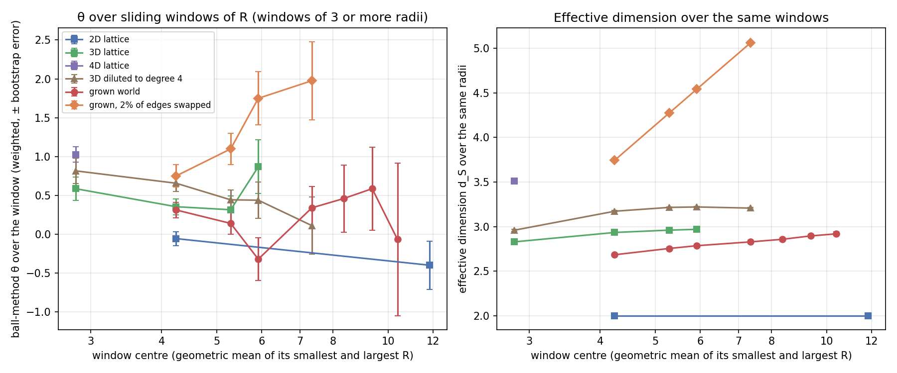

# Step 4: control worlds

**Questions.**
1. The 3D lattice diluted to degree 4 read a higher θ than the plain 3D lattice. Is that a
   real difference, or a small-size effect that fades with R?
2. Is it the grown world's *geometry* (its short loops and 3D-like growth of balls) that sets
   its θ, or just its mix of node degrees?

No prediction was committed for Step 4 before running it; read these results with that in
mind.

## What was run

All exact (proven optimal), 1-hour limit, **no timeouts**, 1690 samples, 73 min on 12 threads
(`plans/step4_controls.json`).

- **Diluted 3D lattice** (L = 24, each bond kept with probability 2/3): R = 6 (80 more, 200
  in total), R = 7 (150), R = 8 (100). The legacy runs stopped at R = 6.
- **Grown world, fully rewired**: the same grown worlds (16 generations, seeds 0–3) with
  every edge repeatedly swapped (a–b, c–d → a–d, c–b), keeping each node's degree exactly.
  R = 3, 4, 5 (150 each).
- **Grown world, 2% of edges swapped**: the same swaps applied to only 2% of edge pairs
  (about 4% of edges move). R = 3–8 (200, 200, 200, 150, 100, 60).

`python calibrate.py` reproduces every number here (`results/calibration/report.txt`).

## Result 1: the diluted lattice's excess θ fades with R

| Diluted 3D, window | R 2–4 | R 3–6 | R 4–7 | R 6–8 |
|---|---|---|---|---|
| θ (weighted) | +0.82 ± 0.16 | +0.66 ± 0.10 | +0.44 ± 0.13 | +0.11 ± 0.37 |
| effective dimension d_S | 2.96 | 3.17 | 3.22 | 3.21 |
| 3D lattice, same window | +0.59 ± 0.15 | +0.36 ± 0.10 | +0.32 ± 0.18 | (not reachable) |

The diluted lattice's effective dimension barely changes over these radii, yet its θ falls
steadily, from +0.82 to about +0.1 to +0.4. At R = 4–7 it is within errors of the plain 3D
lattice. This is the same downward drift at fixed dimension that the 2D lattice showed in
Step 2. It fits the standard expectation that bond dilution does not change the spin glass's
universality class: the excess was a small-size effect of the method, not different physics.

## Result 2: with the geometry destroyed, the result is not a spin glass at all

Fully rewiring keeps every degree but removes almost all short loops: 11,100 triangles become
about 10. A random graph's loops are about 18 steps long, so every ball we can solve (R ≤ 5)
is almost a tree (as many edges as spins). A tree has no frustration. The ball method then
returns θ ≈ +4 (R = 3–6: +4.02 ± 0.19), which is the cost of cutting a branching tree
between two caps, not a spin-glass exponent.

**So the grown world's θ is not set by its degree mix.** Its short loops are essential. This
is close to a foregone conclusion once the balls turn out to be trees, which is why the
partial rewiring below was added.

## Result 3: a world whose dimension climbs fast has a θ that climbs with it

Swapping 2% of edge pairs keeps most short loops (about 9,900 of 11,100 triangles remain on
seed 0) but adds shortcuts, so balls grow faster: the effective
dimension rises from 3.2 at R = 3–4 to 5.1 at R = 6–9. (A world with shortcuts has no fixed
dimension at large scale; these are values at the measured radii only.)

| 2% swapped, window | R 3–6 | R 4–7 | R 5–7 | R 6–8 |
|---|---|---|---|---|
| effective dimension | 3.74 | 4.27 | 4.54 | 5.06 |
| θ (weighted) | +0.75 ± 0.14 | +1.10 ± 0.20 | +1.75 ± 0.34 | +1.98 ± 0.50 |

θ rises with R as the effective dimension does, which is the qualitative prediction of "θ
follows the dimension the world has at that scale". Read against the lattice line of Step 2
(θ the method gives a lattice of that effective dimension, same radii):

| World | window | lattice line predicts | measured | difference |
|---|---|---|---|---|
| grown | R 3–6 | +0.25 ± 0.08 | +0.31 ± 0.10 | +0.07 ± 0.13 |
| grown | R 4–7 | +0.27 ± 0.14 | +0.14 ± 0.14 | −0.13 ± 0.20 |
| diluted 3D | R 3–6 | +0.46 ± 0.13 | +0.66 ± 0.10 | +0.20 ± 0.17 |
| diluted 3D | R 4–7 | +0.38 ± 0.23 | +0.44 ± 0.13 | +0.07 ± 0.26 |
| 2% swapped | R 3–6 | +0.71 ± 0.21 | +0.75 ± 0.14 | +0.04 ± 0.25 |
| 2% swapped | R 4–7 | +0.63 ± 0.47 | +1.10 ± 0.20 | +0.47 ± 0.51 |

Every world is within about 1σ of the line. For the 2%-swapped world this needs a long
extrapolation of the line (from 2D and 3D up to d ≈ 3.7–4.3), so it is a loose check.

## What it changes

- **Evidence for the working hypothesis widens.** Three different kinds of world (grown,
  diluted, partly rewired), with effective dimensions from 2.7 to 4.3 at the same radii, all
  give the θ that a lattice of the same effective dimension gives, within errors of
  0.13–0.5. None needs extra physics.
- **The ball method's small-R bias depends on R, not only on dimension.** At fixed effective
  dimension θ falls with R (2D lattice, diluted 3D). So comparisons have to be at the same R
  *and* the same dimension; the lattice line does that up to R = 7.
- **The geometry, not the degree mix, carries the physics.** With the same degrees and no
  short loops the system is not a spin glass on the scales we can measure.

## Caveats

- No prediction was written before Step 4. The partial-rewiring control was added after
  seeing that full rewiring gives trees, and its rewiring fraction (2%) was chosen from a
  dimension check, not from any stiffness data.
- Two diluted worlds and four rewired worlds. For the rewired worlds the bootstrap that also
  resamples worlds gives errors about 1.4× larger (in `report.txt`), so world-to-world
  differences may matter there; the 2%-swapped conclusions survive with those errors.
- The lattice line is only defined up to R = 7 and d ≈ 3 (4D only at R = 2–4), so the
  2%-swapped world is compared with an extrapolation.
